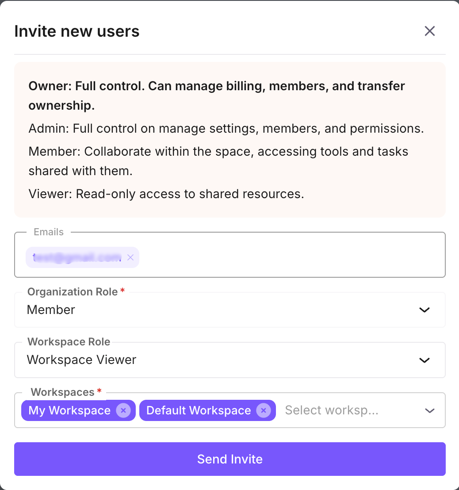

A teammate who accepts an invitation joins the organization, but a Member or Viewer has no access to a workspace until they are assigned to it. This guide invites a member with an organization role and a [workspace](/docs/admin-settings/workspace-management) role, checks that the invitation was accepted, and shows how to change or remove access later.

<Prerequisites title="Before you start">
- Check your [role and permissions](/docs/roles-and-permissions). Organization Owners and Admins manage organization members. A Workspace Admin can invite people but grant access only to workspaces they manage.
- Have the member's email address and intended role ready. You can invite at your own role or below it; an Admin cannot invite an Owner.
</Prerequisites>

## Choose the scope

Owners and Admins automatically have admin access to every workspace. Members and Viewers need explicit workspace membership. Within each workspace, you can assign `workspace_admin`, `workspace_member` or `workspace_viewer` independently of the organization role.

<Mermaid chart={`flowchart TD
  accTitle: Organization membership and workspace access
  accDescr: After accepting an invitation, Owners and Admins have admin access in every workspace. Members and Viewers need explicit assignments in the workspaces they use.
  I["Accepted organization invitation"] --> R{"Organization role"}
  R -->|Owner or Admin| A["Admin access in every workspace"]
  R -->|Member or Viewer| M["Access in assigned workspaces"]`} />

## Invite a member

1. Open **Organization > Members** in settings.
2. Select **Invite User**.
3. Enter the teammate's email address.
4. Select the organization role: **Owner**, **Admin**, **Member** or **Viewer**, within your permission level.
5. Choose the **Workspace Role** for the access you want to grant.
6. Select the relevant **Workspaces**.

   

7. Select **Send Invite**.

   You should see **Pending** until the teammate accepts the email invitation.

## Check acceptance and access

1. Search the member list by name.
2. Use the status filter to distinguish **Pending** from **Active**. You can also show all statuses or filter by organization role.
3. After acceptance, open the assigned workspace's **Members** tab.
4. Check the member's workspace role against the access you intended to grant.

## Change or remove access

| What you need to do | Action and consequence |
| --- | --- |
| Change an organization role | Use the edit action on the member's row. Admins cannot manage Owners or other Admins. |
| Change one workspace | Edit the user's workspace assignment or workspace role. Removing only that assignment leaves the member in the organization. |
| Remove someone from the organization | Use the delete action on the member's row. They immediately lose access to all organization workspaces, but their data is preserved. You cannot remove yourself or the last Owner. |
| Restore access | Reactivate a previously removed member from the members list. Their original role is preserved. |

## Troubleshooting

- **The invitation is still Pending.** An invitation is valid for 7 days. If it expired, resend it from the members list, then check the status again after the teammate accepts.
- **A Member or Viewer can't open a workspace.** They need explicit workspace membership. Edit the user and assign the workspace and a workspace role.
- **You can't select a role or manage a member.** You can only invite at a role equal to or below your own, and you can't manage a user at or above your own role. Only Owners can manage other Owners.

## Next

- [Organization settings](/docs/admin-settings/organization-settings): set the organization name and require two-factor authentication for every member.
- [Profile security](/docs/admin-settings/profile-security): set up a second factor on an individual account.
- [API keys](/docs/admin-settings/api-keys): create the keys your applications authenticate with.
