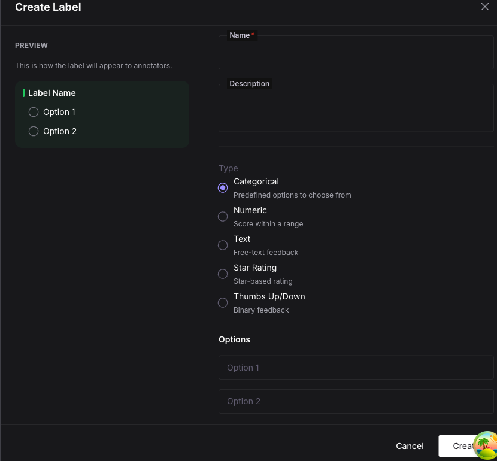

Create a [label](/docs/annotations/concepts/labels) when reviewers need to answer the same question consistently. For `Response quality`, each reviewer will choose `Good`, `Needs work`, or `Wrong`; that answer becomes a [score](/docs/annotations/concepts/scores).

<Prerequisites title="Before you start">
- A name for the label that is unique within your organization.
- The question reviewers will answer and the type of answer it needs. The type is locked once you save.
</Prerequisites>

<Mermaid chart={`flowchart LR
  accTitle: From a review question to a score
  accDescr: Name the label, choose its fixed answer type, define the allowed values, and save it. Reviewers can then use it in a queue or inline.
  A[Name label] --> B[Choose type] --> C[Define options] --> D[Save label] --> E[Use in a queue or inline]`} />

## Open the label form

1. Open **Annotations** in the sidebar.
2. Select **Labels**.

   Labels created here belong to the organization, not a single project. If none exist, you should see “No labels created yet.” instead of a table.

3. Select **Create Label**.
4. In **Name**, enter `Response quality`.

   `Relevance`, `Tone`, and `Accuracy` are examples in the empty field, not a list you have to choose from.

5. Optionally fill in **Description**.

## Choose the answer type

<Warning>
The type is locked once you save. Editing a label later lets you change its name, description, and settings, but not its type. If you pick the wrong type, create a new label.
</Warning>

1. In **Type**, select **Categorical** for the three response-quality options.

   The **Options** fields should appear below the type selector.

For another question, choose the [label type](/docs/annotations/reference/label-types-and-values) that fits the answer:

| Type | Answer |
| --- | --- |
| **Categorical** | A predefined set of options to choose from |
| **Numeric** | A score within a configured range |
| **Text** | Free-text feedback |
| **Star Rating** | A rating in stars |
| **Thumbs Up/Down** | A binary judgment |

## Set the options and save

1. Add `Good` as an option.

   Use it for a response that fully answers the question and matches your tone guidelines.

2. Add `Needs work`.

   Use it for a response that is correct but incomplete, robotic, or missing context.

3. Add `Wrong`.

   Use it for a response that is factually incorrect or answers a different question than the one asked. [Create a queue](/docs/annotations/guides/create-queue) gives reviewers the same three definitions as queue instructions.

4. Check **Allow notes** if reviewers should be able to explain a choice.

   Leave it unchecked if you want only the selected value.

5. Select **Create**.
6. Look for `Response quality` in **Labels**.

   The saved label is available to attach to a [queue](/docs/annotations/concepts/queues-and-items) or to use inline without a queue.

If **Create** returns an error toast, check for at least two distinct, non-empty options. The form allows you to enter `Good` and `good`, but rejects them as duplicates on submission. Remove the duplicate and select **Create** again.

## Manage a saved label

| Control | When to use it |
| --- | --- |
| **Search** or the type filter | Find a label by name or narrow the list to one answer type. |
| **Edit** | Change the name, description, or settings. Attached queues share those changes; existing scores stay as submitted. |
| **Duplicate** | Open the form with the settings filled in under a new name, then adjust and save it separately. |
| **Archive** or **Restore** | Take a label out of active use, or bring it back from the **Archived** view. |

## Create a label from code

The [Python and TypeScript SDK reference](/docs/sdk/reference/annotations#annotationslabelscreate) documents `client.annotations.labels.create`. The [Create Annotation Label endpoint](/docs/api/annotations/labels/create-label) describes the type, settings, notes, and optional project scope. For programmatic creation, the categorical settings include the options and the auto-annotation fields `rule_prompt`, `auto_annotate`, and `strategy`.

## Next

- [Create a queue](/docs/annotations/guides/create-queue): attach the label so your reviewers see the same choices.
- [Annotate without a queue](/docs/annotations/guides/annotate-without-a-queue): score a single item inline.
- [Understanding annotation](/docs/annotations/concepts/understanding-annotation): see how reusable labels, items and submitted scores fit together.
