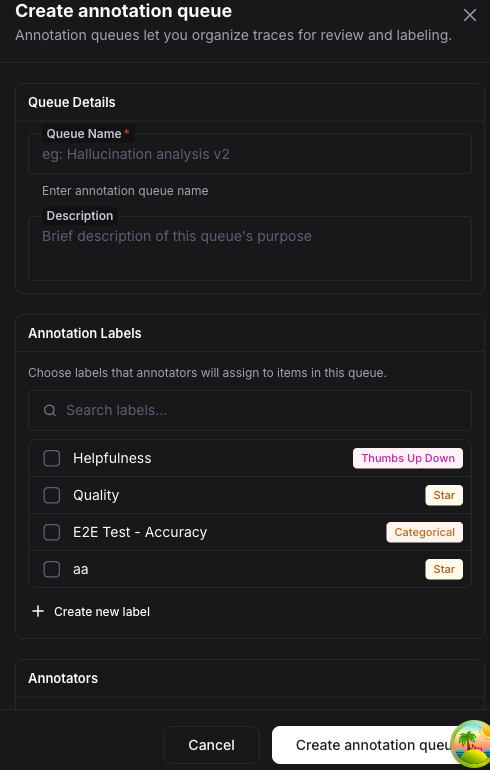

To compare two people's judgments of the same response, both have to answer the same [label](/docs/annotations/concepts/labels) on the same item. A [queue](/docs/annotations/concepts/queues-and-items) sets that up: it attaches labels to a set of items, adds the people who answer them, and sets how many independent submissions each item needs. This guide builds one running example, `Support quality review`, which collects two `Response quality` submissions per item.

<Prerequisites title="Before you start">
- Have at least one label ready. [Create the Response quality label](/docs/annotations/guides/create-label) if needed; a queue cannot be saved without a label.
- You need a second workspace member for two submissions per item. [Invite a teammate](/docs/admin-settings/user-management) if needed. Working solo? Use one submission instead.
- Reviewer approval needs the review workflow entitlement; see [Queue settings & limits](/docs/annotations/reference/queue-settings-and-limits). A reviewer can't review an item they annotated themselves, so plan for a reviewer who is not answering the same items.
</Prerequisites>

## Decide who can pick up an item

Two settings decide who answers what, so choose them before you open the drawer.

- **Auto-assign items to all annotators:** turn it on and every annotator is assigned to every item, so anyone can open anything. Leave it off and assignment is manual, which means a manager has to hand items out.
- **Submissions per item:** how many different annotators have to answer each item before it's done. It can't exceed the number of annotators you add.

<Mermaid chart={`flowchart TD
  accTitle: From queue settings to an active queue
  accDescr: Attach a label, select annotators and set the submission count. Creation saves a draft. Activation opens the queue for work but adds no items.
  L["Attach Response quality"] --> A["Select two annotators"] --> N["Require two submissions"] --> D["Create draft"] --> Q["Activate empty queue"]`} />

## Name the queue and attach a label

1. Open **Annotations**.
2. Switch to **Queues**.
3. Select **Create Queue**.

   A queue can belong to a project, a [dataset](/docs/dataset) or an agent definition, or to none of them. This drawer doesn't ask you to pick one, so `Support quality review` is an org-level queue.

4. Enter `Support quality review` in **Queue Name**.

   The name is required. It has to be unique, case-insensitively, among the queues you haven't archived in the same scope.

5. Optionally add a **Description** explaining what the queue is for.
6. Under **Annotation Labels**, tick `Response quality`.

   At least one label is required. The drawer won't let you save without it.



## Choose the annotators

1. Find your own row in the annotator picker. It is tagged (creator).

   Your row starts selected as Annotator, Reviewer and Manager, so you already count toward submissions per item. Untick Annotator if you don't want to answer items yourself.

2. Add one more workspace member as an annotator. You and they make two.
3. Tick or clear **Auto-assign items to all annotators**, as you decided above.
4. Set **Submissions per item** to `2`.

   Every item now needs two independent takes on `Response quality` before it's complete.

5. Optionally, write queue-wide guidance in **Instructions**.

**Instructions** is a free-text field with Markdown support, and it shows up in the annotation workspace. Use it for guidance that applies to every item and label in the queue, not notes on a single label. For example:

```markdown
Rate the agent's final response, not the whole conversation.

- **Good**: fully answers the question and matches our tone guidelines
- **Needs work**: correct but incomplete, robotic, or missing context
- **Wrong**: factually incorrect or answers a different question than the one asked
```

## Open Advanced settings

**Advanced settings** is collapsed by default. Expand it if you need to change one of its three fields.

| Setting | What changes |
| --- | --- |
| Assignment strategy | **Manual** is the only one you can pick today. **Round Robin** and **Load Balanced** are disabled, with a **Coming soon** chip. |
| Reservation timeout | How long an item stays reserved for the annotator who opened it: 15 minutes, 30 minutes, 1 hour (the default) or 4 hours. When it expires, the item is released back to the queue for another annotator. |
| Require reviewer approval | A fully annotated item lands in review instead of finishing outright. It needs the review workflow entitlement. Without it, turning the setting on fails with an upgrade prompt. |

## Create and activate the queue

1. Click **Create annotation queue**.

   The queue saves in Draft. Draft can only move to Active, and annotating doesn't start until you make that move.

2. Open the queue's row menu.
3. Click **Activate**.
4. Open the queue and switch to the **Items** tab.

   The tab shows **No items in this queue**. Activating doesn't add any items, so the queue starts empty. From Active, a queue can move to Paused and on to Completed.

## Create or activate from code

The [queue SDK reference](/docs/sdk/reference/annotation-queues) lists the create and status-update methods for Python and TypeScript. Over REST, [create the queue](/docs/api/annotations/queues/create-queue) first, then [update its status](/docs/api/annotations/queues/update-status) to `active`. As in the dashboard, creating and activating are separate calls.

## Next

- [Add items](/docs/annotations/guides/explore-queue/add-items): put the first sources into the empty queue and assign them.
- [Explore a queue](/docs/annotations/guides/explore-queue): find settings, progress and the items table.
- [Review submissions](/docs/annotations/guides/review-submissions): compare independent answers if you enabled reviewer approval.
