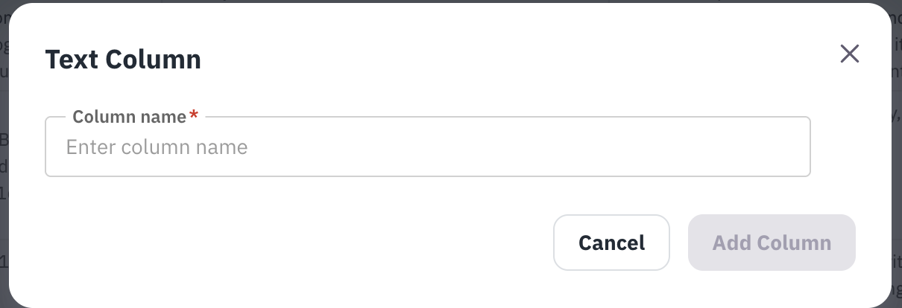

A reviewer's note and a topic label both belong beside a customer question, but they get there differently. Use a [static column](/docs/dataset/concepts/static-and-dynamic-columns) for the note you type, or a dynamic column to classify each question. Both start in the same panel: a static column is created as soon as you name it, while a dynamic column opens a fuller form and lets you test it first.

<Prerequisites title="Before you start">
- An existing [dataset](/docs/dataset/guides/create-a-dataset) that you can edit.
- For the classification example, a text column named `user_query` with questions to classify.
</Prerequisites>

<Mermaid chart={`flowchart LR
  accTitle: Choose a column by who supplies the value
  accDescr: From Add Column, choose Text to store reviewer notes, or Classification to preview and then assign a topic to each question.
  A["Add Column"] --> T["Text"] --> N["Empty reviewer_notes cells"]
  A --> C["Classification"] --> P["Preview labels"] --> Q["Labels in query_topic"]`} />

## Add a static column for notes

1. On the dataset's **Data** tab, select **Add Column**.

   The panel groups types under **All**, **Static Columns** and **Dynamic Columns**; you can also search by name.

2. Select **Static Columns**.
3. Choose **Text**.

   

4. Enter `reviewer_notes` in **Column name**.
5. Select **Add Column**.

   You should see an empty `reviewer_notes` column in the grid, ready to fill one cell at a time. For other static types, see [column data types](/docs/dataset/reference/limits-and-data-types).

## Preview a dynamic column for topics

[Classification](/docs/dataset/reference/dynamic-column-methods#classification) reads another column's text and sorts each row into one of the labels you define. Unlike **Text**, it needs a source column and a model. Run Prompt is a dynamic column too. It has its own walkthrough, listed under Next with the catalog of every other method.

1. Select **Add Column** on the **Data** tab.
2. Select **Dynamic Columns**.
3. Choose **Classification**.
4. Name the output column `query_topic`.
5. Choose `user_query` as the source column.
6. Enter the labels the model can assign, for example `Billing`, `Technical` and `Account`.
7. Choose the model for classification.
8. Set concurrency to the number of rows to process at once.

## Check the preview before creating the column

1. Select **Test**.

   You should see proposed labels without saving the column. Compare a question with its proposed topic; if the categories aren't useful, revise the labels before creating it.

2. Select **Create New Column** when the preview is ready.

   Classification starts on every row and fills `query_topic` as it runs.

## If a column name is rejected

A column name can be up to 255 characters and must be unique within its dataset. When you add more than one column in one request, for example through the SDK, the new names must also be distinct from one another.

For static columns, the [dataset SDK reference](/docs/sdk/reference/datasets) lists `datasets.columns.add_static` in Python, `datasets.columns.addStatic` in TypeScript, and the `create_dataset_column` MCP tool. These take the dataset ID, new name, and column type; they are not the Classification preview.

## Next

- [Run a prompt on every row](/docs/dataset/guides/run-a-prompt-on-every-row): generate a reply rather than a category for each question.
- [Dynamic column methods](/docs/dataset/reference/dynamic-column-methods): choose another way to compute a value from row data.
- [Manage datasets](/docs/dataset/guides/manage-datasets): rename a column, change its type, or remove it.
