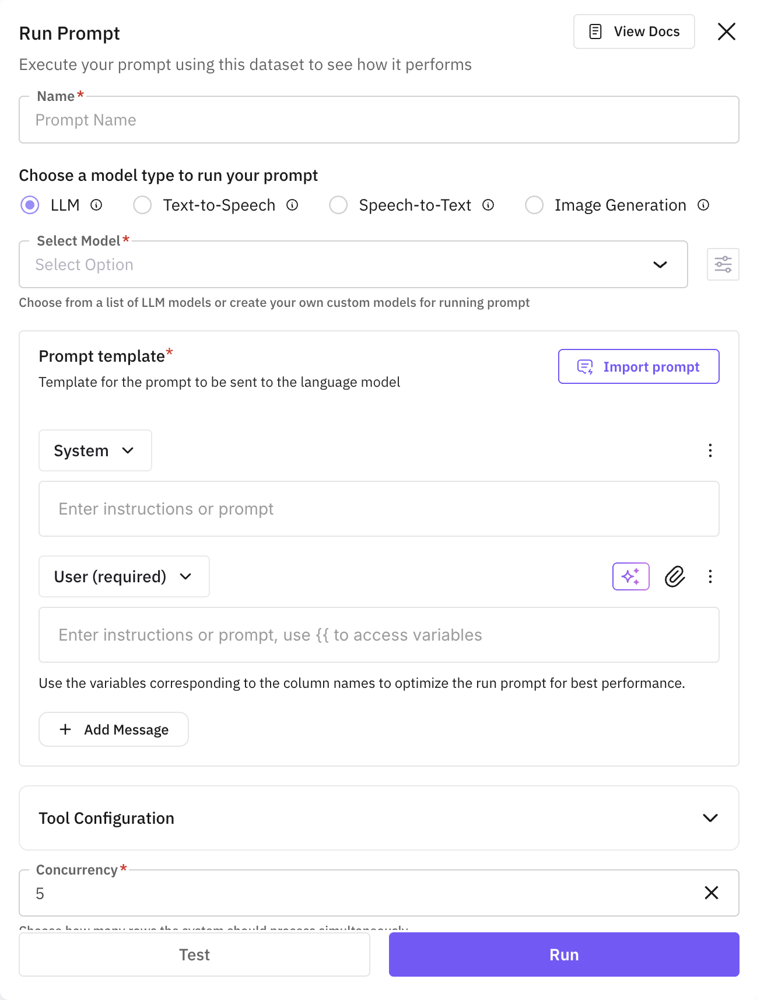

Generate a support reply for each customer question without copying rows into a prompt editor. **Run Prompt** reads the question and plan from the current row and writes the reply back to that row in a new [dynamic column](/docs/dataset/concepts/static-and-dynamic-columns).

<Prerequisites title="Before you start">
- A [dataset](/docs/dataset/guides/create-a-dataset) with at least one input row.
- For this example, a text column named `user_query` and a JSON column named `customer_context` with a `plan` field.
</Prerequisites>

<Mermaid chart={`flowchart LR
  accTitle: One dataset row becomes one support reply
  accDescr: The user query and the plan field of the same row fill the user message. The model's reply goes to that row's model_response cell.
  Q["user_query"] --> M["User message"]
  P["customer_context.plan"] --> M
  M --> L["Selected model"] --> R["model_response cell"]`} />

## Choose the model for the output column

1. On the dataset's **Data** tab, select **Run Prompt**.

   

2. Enter `model_response` in **Name** (the field with the **Prompt Name** placeholder).

   This becomes the name of the column every row's response lands in.

3. Choose **LLM** as the model type for a text reply.
4. Choose the specific model under **Select Model**.

   If the LLM you need is missing, you can [register a custom model](/docs/evaluation/guides/custom-models) to add it to the list.

## Build the support message

[Prompt variables](/docs/prompt/concepts/understanding-prompts#variables) reference columns by name. A plain reference reads the whole cell; dot notation reads just the named field of a JSON cell.

<Steps>
  <Step title="Write the system message">
    Use the optional system message to set the model's role.

    ```
    You are a support assistant that helps resolve customer tickets.
    ```
  </Step>
  <Step title="Write the user message with the question">
    In the required user message, use `{{user_query}}` for the customer's question.
  </Step>
  <Step title="Bind the plan field in the same message">
    Use `{{customer_context.plan}}` for the plan rather than passing the entire JSON object. The complete user message should read:

    ```
    A customer asked: {{user_query}}. Their plan is {{customer_context.plan}}. Write a helpful response.
    ```
  </Step>
</Steps>

## Set run options

1. Set **Concurrency** to the number of rows to process at once, from 1 to 10 (default 5).
2. Adjust any generation settings you need using the options button beside **Select Model**.

   Settings include temperature, top P, max tokens, presence and frequency penalty, and response format.

3. If your prompt needs tools the model can call while it runs, attach them under **Tool Configuration** above **Concurrency**.

## Run and inspect one row

1. Select **Run**.

   Future AGI works through the dataset row by row and writes each response into the new column. The column is done once every cell has filled.

2. Find the `model_response` cell beside a question and its plan.

   A row in progress shows a loading placeholder. A successful LLM cell shows the reply and records token counts and response time; a failed call shows an error instead.

3. Compare the completed cell with `user_query` and `customer_context.plan` in that same row.

   The prompt uses each row's own inputs, so check other rows against their own questions rather than expecting the same reply everywhere.

## Use another model type

<div class="sdk-ref-table max-sm:[&_td]:px-1.5! max-sm:[&_th]:px-1.5!">

| Model type | Input to configure | Output |
| --- | --- | --- |
| **LLM** | A message list, as above. | Text |
| **Text-to-Speech** | Reference a text column such as `{{script_text}}` in **Prompt Input** and choose a required **Voice**. | Audio |
| **Speech-to-Text** | In **Voice Input**, select an audio column from **Column**; selection fills the message. | Transcribed text |
| **Image Generation** | Write a single description in **Image Prompt**. | Image |

</div>

The [dataset SDK reference](/docs/sdk/reference/datasets#datasetspromptsadd) documents `datasets.prompts.add` for Python and TypeScript and `add_dataset_prompt` for MCP. This operation creates an output column and schedules processing, which can incur model charges. It isn't the workbench operation for running a single prompt version.

## Next

- [Add columns](/docs/dataset/guides/add-columns): store notes or classify the questions alongside their replies.
- [Dynamic column methods](/docs/dataset/reference/dynamic-column-methods): choose another way to compute row values.
- [Run an experiment](/docs/dataset/guides/run-an-experiment): compare multiple prompts or models on the same questions.
