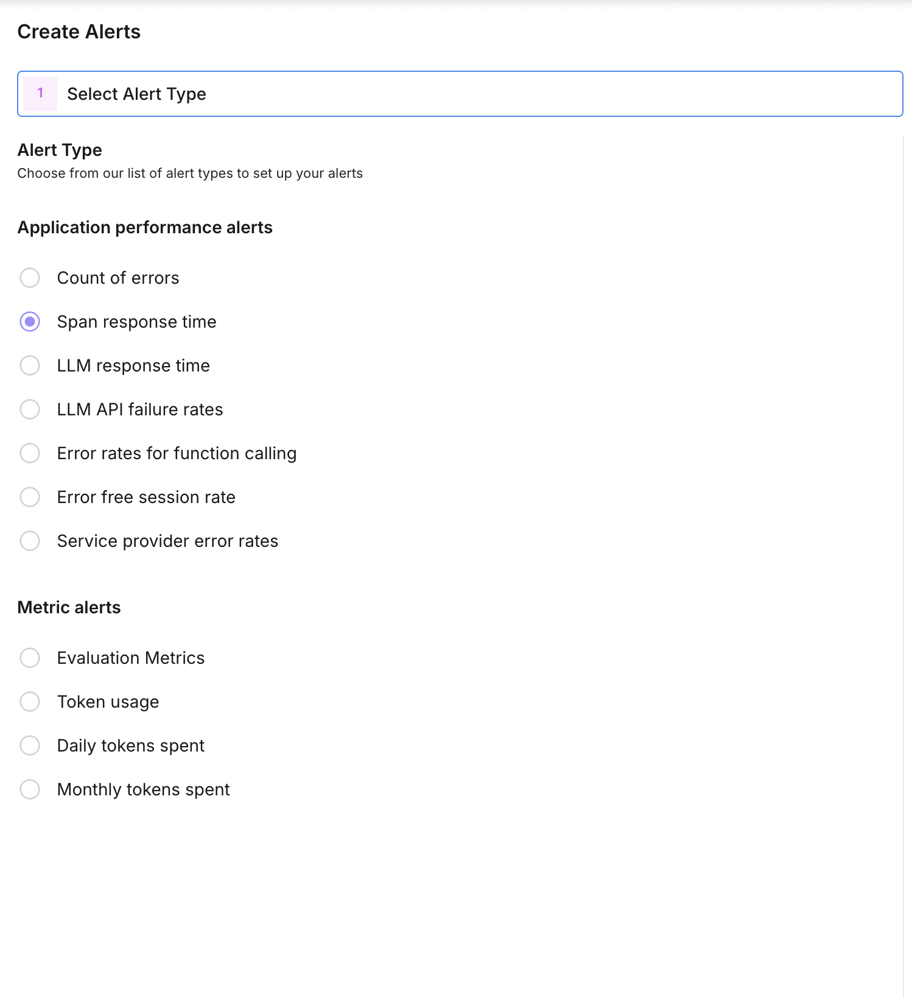
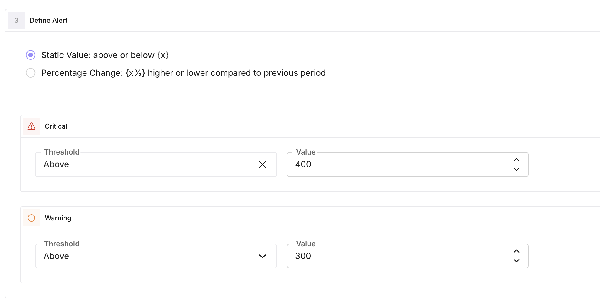
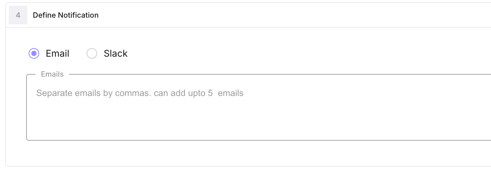

An email says span response time crossed a threshold. Before you act on it, check when the alert fired, whether it's still unresolved, and whether everyone who should know was notified. Open the monitor in [Observe](/docs/observe) to read its log, resolve the individual alert, or mute future notifications.

A monitor checks one metric on a schedule and notifies you by email, Slack, or both when the value goes above or below the threshold you set. Use monitors to:

- Catch a spike in error rate or API failure rate after a deployment.
- Know when response time goes above your target.
- Track token usage and get a warning before you hit your budget.
- Know when a pass/fail eval such as [toxicity](/docs/evaluation/builtin/toxicity) starts failing more often.
- Stay informed without watching a [dashboard](/docs/observe/features/dashboard).

<Prerequisites title="Before you start">
- An existing monitor on a project with `trace_type` set to `observe`. If you need one, [set up an alert](/docs/observe/guides/setup-alerts) first; that guide creates the `Slow span time` monitor used here.
</Prerequisites>

<Mermaid chart={`flowchart LR
  accTitle: Distinguish a missed breach from a delivery problem
  accDescr: Start with the log for the expected breach. No matching entry calls for checking the schedule and threshold. If an entry exists, check the delivery channel for a missing message or resolve a handled alert.
  H["Monitor history"] --> N["No matching entry"] --> T["Check schedule and threshold"]
  H --> E["Matching entry"] --> D["No notification: check delivery"]
  E --> R["Breach handled: resolve entry"]`} />

## Read the monitor history

1. Open **Alerts** in the sidebar.
2. Find the monitor for your project.

   A new monitor shows **Healthy**, zero triggers, and no **Last Triggered** time. When the metric crosses a threshold, the status changes to **Warning** or **Critical** and **Last Triggered** shows the time.

   

3. Open the monitor detail view.

   You should see the trend and the number of unresolved alerts.

4. Read the log entry for the time in question.

   Each `UserAlertMonitorLog` records a warning or critical alert, a message, a time window, and a link.

5. Compare the log with the email or Slack notification for that breach.

   An email includes the alert name, message, and type; a Slack message can include the monitor's optional notes.

## Read the rule that fired

The setup guide's monitor watches response time for [spans](/docs/observe/concepts/spans), with a warning above 100 ms and a critical threshold above 200 ms. Those are settings, not measured response times. Check the following fields when interpreting your own log.

| Setting | What it means for an alert |
| --- | --- |
| Metric | System metrics include error count, error-free session rate, LLM API failure rate, span and LLM response times, token usage, and daily or monthly tokens spent. |
| Evaluation metric | An [eval score](/docs/observe/features/evals) comes from an eval configuration on this project. For a pass/fail or choice eval, `threshold_metric_value` selects the value to watch, such as failures on toxicity or a specific label. |
| Filters | Optional `filters` use the same structure as eval-task filters and limit which spans count. |
| Direction | `threshold_operator` compares the metric to the threshold using **Greater than** or **Less than**. |
| Static threshold | `threshold_type` is static: `critical_threshold_value` and optional `warning_threshold_value` are fixed values. |
| Percentage change | The same threshold fields are percentages relative to a historical baseline. `auto_threshold_time_window` sets the baseline window in minutes; the default is one week. |
| Frequency | `alert_frequency` sets the check interval in minutes: minimum 5, default 60. A brief spike between checks may not appear in the log. |

When the condition is met on a scheduled check, the monitor creates a critical or warning alert log and sends the notifications.

## Resolve an alert or mute notifications

- **The breach has been dealt with:** mark that log entry resolved. Use the monitor detail view to check the unresolved count.
- **The team needs a break from notifications:** mute the monitor with `is_mute`. The monitor keeps evaluating and isn't deleted. Unmute it when notifications should resume.
- **The log has an entry but no one was notified:** check `notification_emails` (up to five addresses), `slack_webhook_url`, or both. `slack_notes` adds optional text to the Slack message. Follow [Alerts did not fire](/docs/observe/troubleshooting/alerts-did-not-fire) to distinguish a delivery problem from a missing log entry.

Compare a breach with the metric over the same period on your dashboard.

## Read alerts from code

The [alerts SDK reference](/docs/sdk/reference/alerts) lists fired logs separately from configured rules. In Python and TypeScript, `alerts.logs.list` lists the alerts that have fired and `alerts.rules.list` lists the configured monitors with their thresholds and projects. The corresponding MCP tools are `list_fired_alerts` and `list_alert_rules`. The reference doesn't list an operation to mute a monitor or resolve an alert.

## Next

- [Set up observability](/docs/observe/features/quickstart): capture the traces that supply the monitor's data.
- [Group traces by session](/docs/observe/features/session): follow the requests that belong to one conversation.
- [Inspect user activity](/docs/observe/features/users): look at activity for a particular user after a breach.
