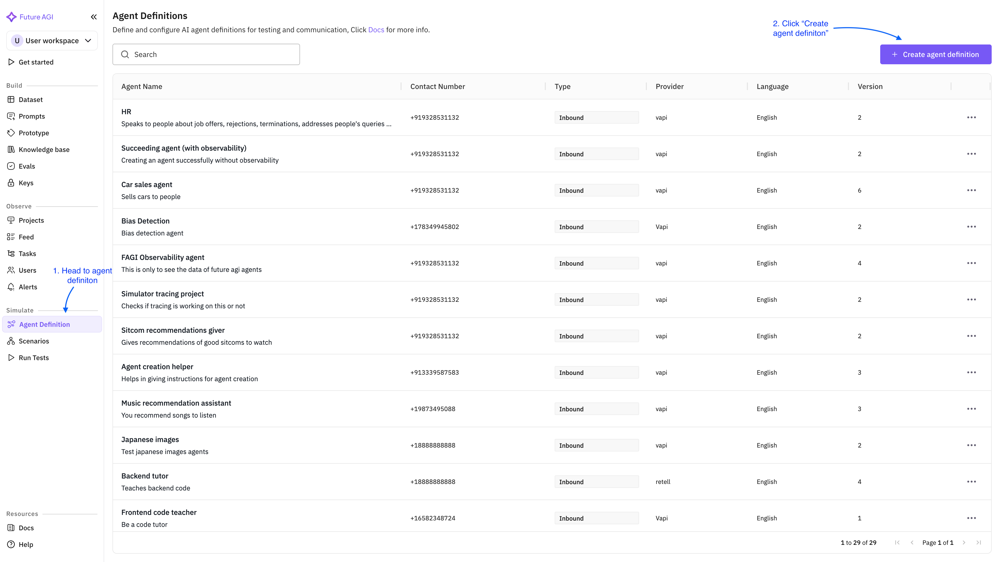
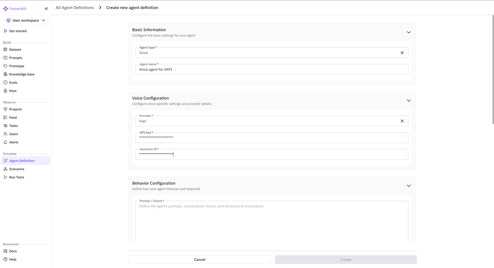
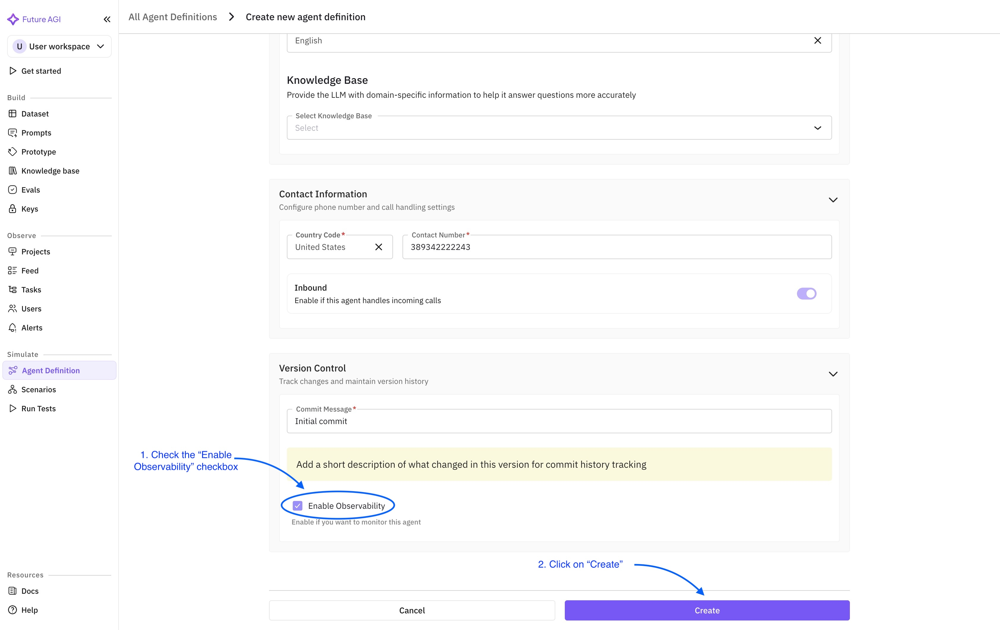
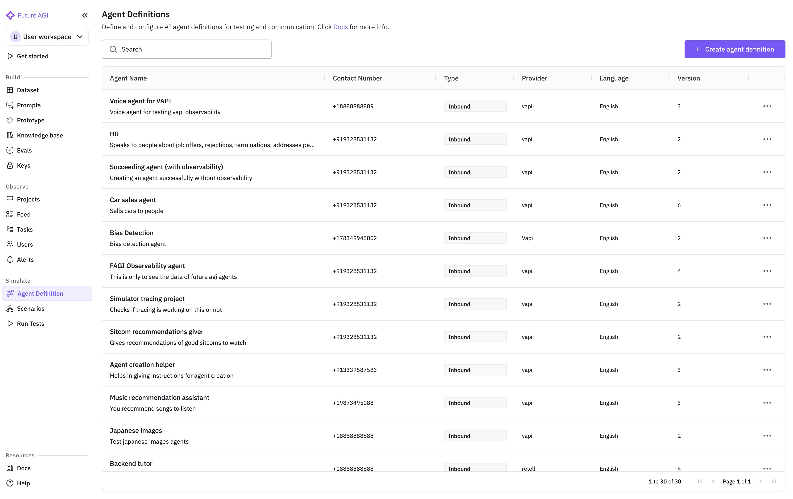
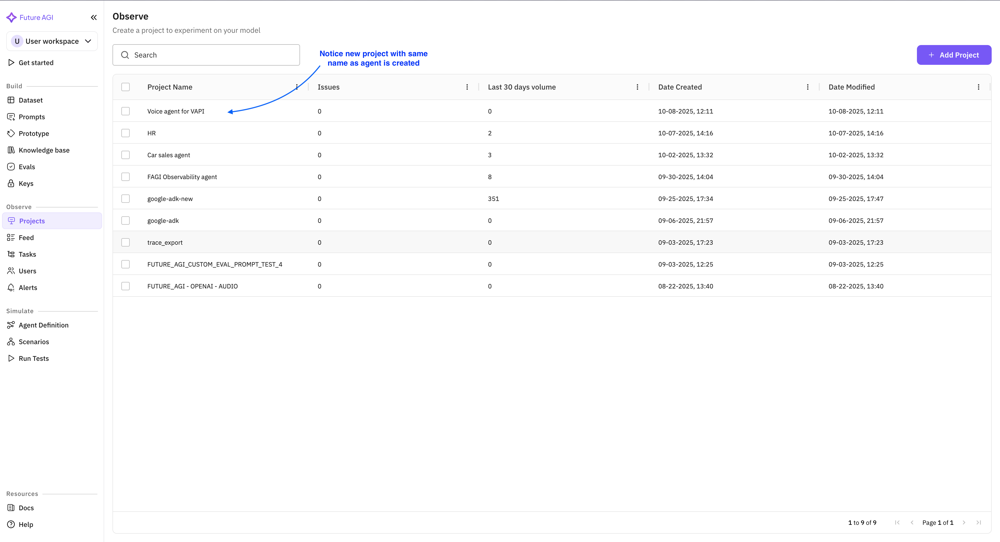
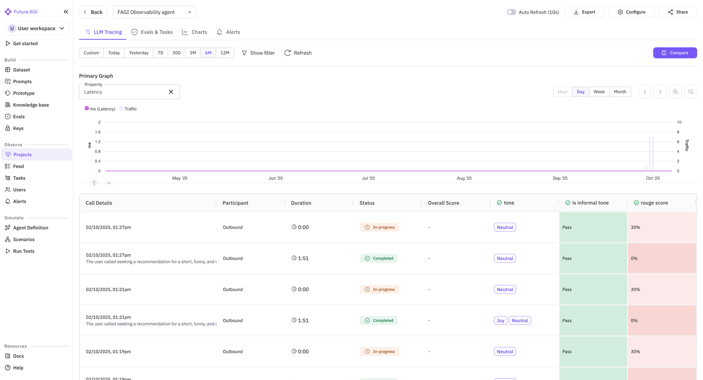
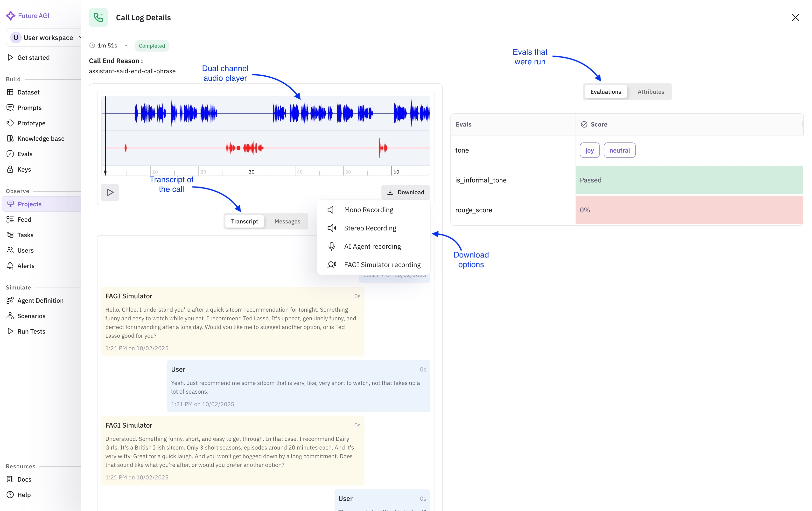
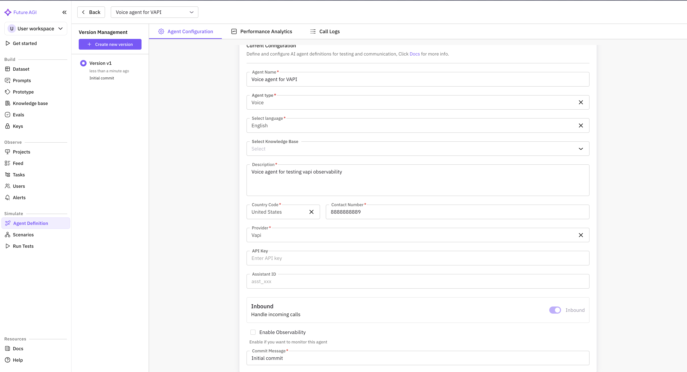
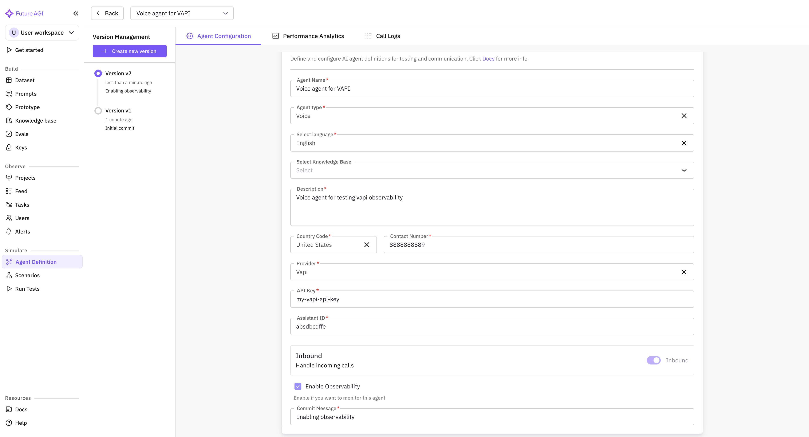

Voice agents are hard to debug. When something goes wrong, you usually find out from a caller's complaint, not a log. Connect Vapi, Retell or Bland.ai with its API key and assistant ID, and [voice observability](/docs/observe/concepts/voice-observability) pulls every call into [Observe](/docs/observe) as a [trace](/docs/observe/concepts/traces) with its transcript, recording URLs, cost and duration. No SDK or code changes are needed. A self-hosted agent has to send its own conversation [span](/docs/observe/concepts/spans) instead.

Use it to:

- See all conversations for a voice agent in one project without adding SDK instrumentation.
- Run evals (quality, bias, adherence) on conversation spans from voice calls.
- Set monitors on voice project metrics and get notified when something degrades.
- Open the transcript and recording URLs from the trace view when you debug a call.
- Search, filter and export calls the same way you would with any other trace.

<Prerequisites title="Before you start">
- For Vapi, Retell or Bland.ai, get the provider API key and assistant ID (or agent ID) from its dashboard. Both are required for managed ingestion.
- To verify delivery, use a completed test call from the assistant you connect. Some providers send the log only after the call ends.
</Prerequisites>

<Mermaid chart={`flowchart TD
  accTitle: Two ways a call reaches Observe
  accDescr: A connected managed provider supplies the call log. A self-hosted agent exports a root conversation span. Both paths lead to a call row with its recorded details.
  P["Managed provider"] --> L["Provider call log"] --> R["Observe call row"]
  H["Self-hosted agent"] --> S["Root conversation span"] --> R`} />

<iframe
  className="w-full aspect-video rounded-xl"
  src="https://www.youtube.com/embed/9XHrT2VFbjQ"
  title="Voice observability walkthrough"
  frameBorder="0"
  allow="accelerometer; autoplay; clipboard-write; encrypted-media; gyroscope; picture-in-picture"
  allowFullScreen
></iframe>

## Connect a managed assistant

1. Open **Agent definition**.
2. Click **Create agent definition**.

3. Enter an agent name.
4. Select the provider.
5. Enter the provider's API key and assistant ID.

   Both are masked for security.

6. Fill in the other required fields.
7. Check **Enable Observability**.

   The API key and assistant ID are required only if observability is enabled.

8. Click **Create**.

   You are redirected to the agent list, where the new agent is now visible.

To create the definition from code instead, the [create agent definition API](/docs/api/agent-definitions/createagentdefinition) takes `observability_enabled` along with the provider API key and assistant ID.

## Find the call

1. Open **Projects**.

   A project with the same name as your agent lists all its call logs.

2. Open that project.

   The voice observability table shows each call with its status, duration and cost.

3. Click a call to open the detail drawer.

   The drawer shows the transcript, the recording URLs and the call data. Read the transcript to find the turn in question, then play the recording to hear it.

## Update or disable observability

1. Click an agent definition to open the edit form. You can edit any field.
2. Check or clear **Enable Observability**.

   If you disable observability, the API key and assistant ID become optional. If you enable it, or keep it on, both are required.

<Tabs>
  <Tab title="Observability disabled">
    
  </Tab>
  <Tab title="Observability enabled">
    
  </Tab>
</Tabs>

## Supported providers

Each of these is pulled for you: Future AGI fetches the call log and writes the conversation span itself, already carrying the transcript, the recording URLs, the duration and the cost from the provider's own payload.

| Provider | Console |
|---|---|
| Vapi | [dashboard.vapi.ai](https://dashboard.vapi.ai) |
| Retell | [retellai.com](https://www.retellai.com/) |
| Bland.ai | [bland.ai](https://www.bland.ai/) |

## If you host the agent yourself

[LiveKit](/docs/integrations/traceai/livekit), [Pipecat](/docs/integrations/traceai/pipecat) and hand-rolled speech-to-text, model and text-to-speech loops are not pulled, because there is no provider to pull from. Nothing arrives until your process sends it, and the call has to be shaped as a conversation span for the Voice tab to list it at all.

[Instrument and verify a voice agent](/docs/cookbook/quickstart/instrument-and-verify-voice) is that path end to end, with a checker that runs twelve gates against the spans your agent really sent and tells you which column will be blank.

## If your call is missing

- **Managed assistant:** Check the provider, the assistant ID and **Enable Observability** on the agent definition. Some providers send the call log only after the call ends, so reopen the project with the same name as the agent a few minutes after the call completes.
- **Self-hosted agent:** If a trace arrived but the Voice tab has no call, check whether the conversation span has a parent. The Voice tab lists only a conversation span with no parent.

## Next

- [Set up observability](/docs/observe/features/quickstart): connect your SDK to capture traces.
- [Run evals on traces](/docs/observe/features/evals): score conversation quality.
- [Alerts and monitors](/docs/observe/features/alerts): get notified when a voice project metric crosses a threshold.
- [Explore users](/docs/observe/features/users): review activity and metrics for an individual caller.
