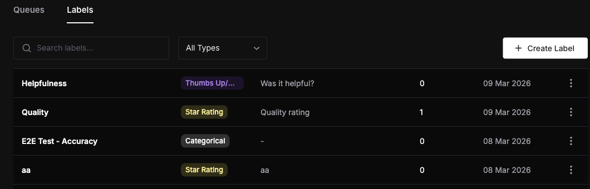
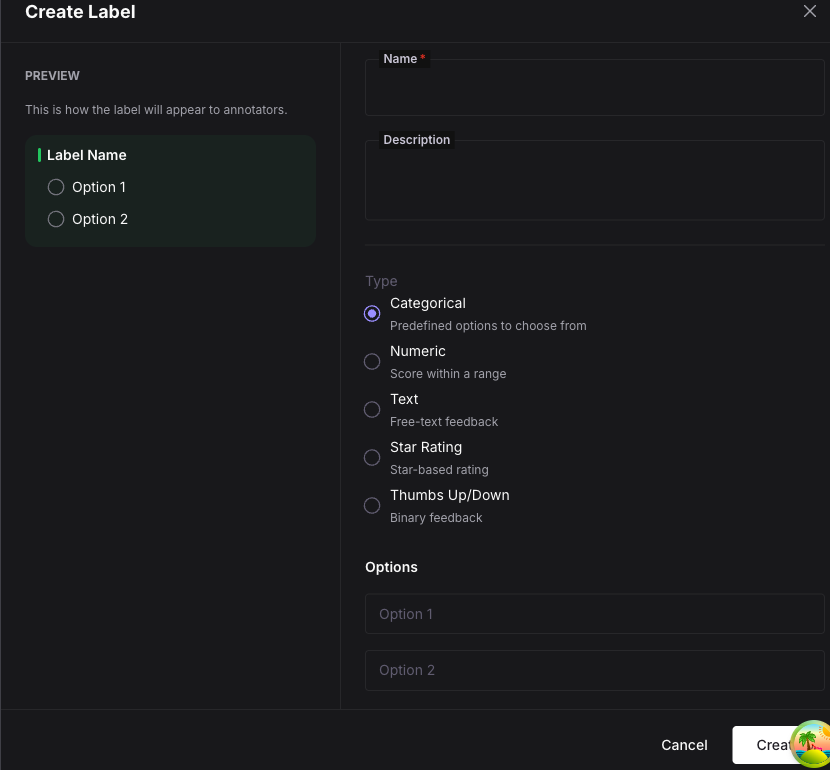
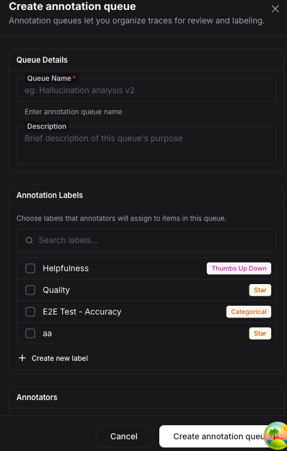
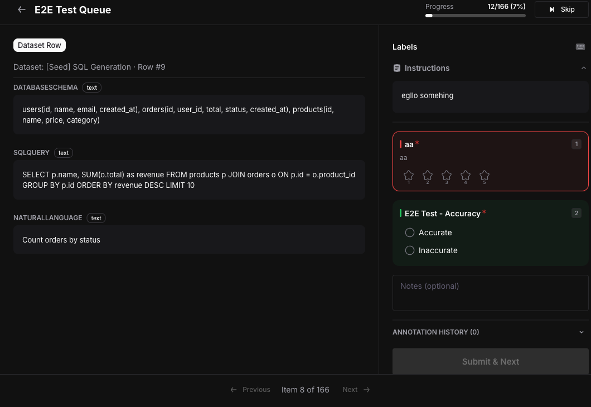
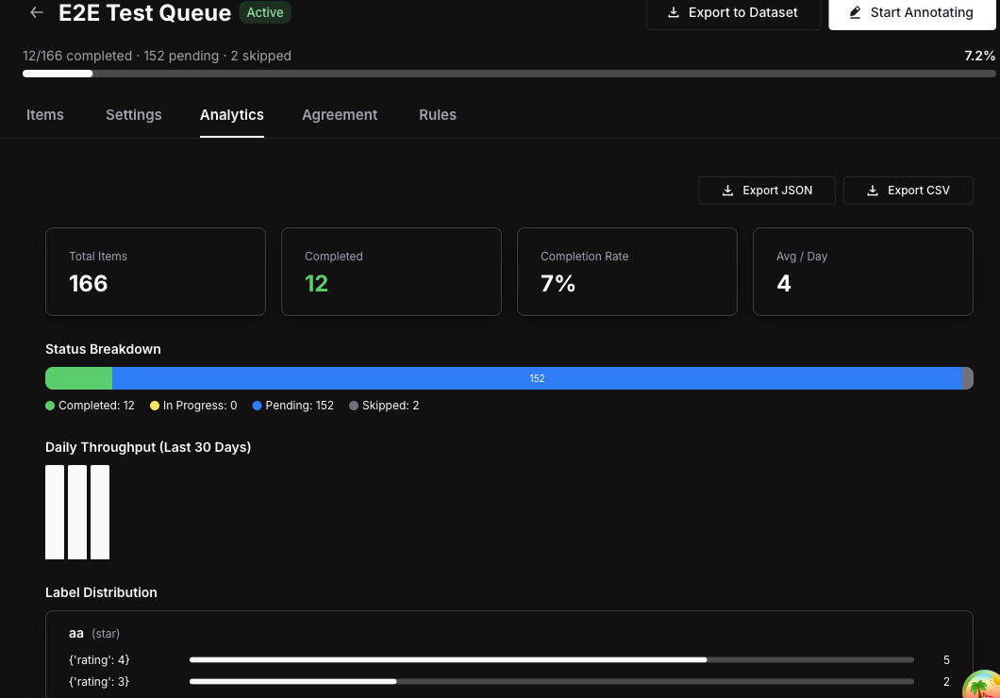

<TLDR>
Use a [label](/docs/annotations/concepts/labels) in a review [queue](/docs/annotations/concepts/queues-and-items) to record the sentiment of one [trace](/docs/observe/concepts/traces).
</TLDR>

## The problem

A trace shows what someone said, but it does not record whether a reviewer reads the exchange as positive, negative or neutral. Without a shared set of choices, two reviewers can describe the same exchange in different terms.

## What you'll build

A queue called `Review Queue` with one categorical label, `Sentiment`, and one trace for you to review.

<Mermaid chart={`
flowchart LR
    accTitle: Review the sentiment of a trace
    accDescr: Attach the label to a queue, add a trace and check the same queue after submitting your judgment.
    A["Sentiment label"] --> B["Review Queue"] --> C["Pending trace"] --> D["Submitted judgment"] --> E["Queue progress"]
`} />

You'll:

1. Define the three allowed sentiment values.
2. Put a trace in a queue assigned to you.
3. Submit one judgment and find it in queue progress.

<Prerequisites title="Before you start">
- Access to **Annotations** to create labels and queues, and a workspace account you can add as an annotator.
- An [Observe](/docs/observe) project with a trace you can read. If it is empty, [send your first trace](/docs/get-started/send-your-first-trace) first.
</Prerequisites>

## Define the sentiment label

1. Open **Annotations > Labels**.

   

2. Select **Create Label**.
3. Enter `Sentiment` as the name.
4. Select **Categorical** as the type.
5. Add `Positive`, `Negative` and `Neutral` as the options.
6. Enable **Allow notes**.

   

7. Select **Create**.

   You should see `Sentiment` in the labels list.

## Create the queue

1. Open **Annotations > Queues**.
2. Select **Create Queue**.

   

3. Name the queue `Review Queue`.
4. Select `Sentiment` under **Annotation Labels**.
5. Keep yourself selected as the only annotator.
6. Enable **Auto-assign items to all annotators**.

   With one annotator, each item goes to you; leave the assignment strategy at **Manual**.

7. Set **Submissions per item** to `1`.
8. Select **Create annotation queue**.

   You should see `Review Queue` in **Draft** status.

## Add one trace

1. Select **Activate** from the queue’s row menu.
2. Open **LLM Tracing** in your Observe project.
3. Select one trace using its checkbox.
4. Select **Add to Queue**.
5. Choose `Review Queue`.
6. Confirm your selection.

   You should see the trace listed as **Pending** in that queue’s **Items** tab.

## Submit your judgment

1. Open `Review Queue` under **Annotations > Queues**.
2. Select **Start Annotating**.

   You should see the trace on the left and `Sentiment` on the right.

   

3. Choose the sentiment that fits the exchange.

   The `1` through `9` keys select a categorical option by position.

4. Optionally, add a note explaining your choice.
5. Select **Submit & Next** (Cmd+Enter or Ctrl+Enter).

   The workspace advances to the next assigned item, or shows **All Done!** if this was the last one. Use **Skip** (`S`) instead if you cannot judge the item; skipping does not complete it.

6. Go back to the queue detail page and open the **Analytics** tab.

   Check that the completion rate, annotator activity and label distribution reflect the item you just reviewed.

   

## Check the queue from code

The [annotation queue SDK reference](/docs/sdk/reference/annotation-queues) documents the same operations in Python and TypeScript. For `Review Queue`, read progress with `client.annotation_queues.progress` in Python or `client.annotationQueues.progress` in TypeScript, passing the queue ID. If submitting from code, read the item detail for the allowed label values, submit the answer, then complete the item: submission alone leaves it in progress.

## Troubleshooting

- **The queue is empty.** Activating a queue does not add traces. Check its **Items** tab; if the trace is missing, add it from the project and confirm it appears as **Pending**.
- **The trace is there but I cannot annotate it.** Check that the queue is active and the item is assigned to you. Reopen the item and look for the `Sentiment` choices.

## Next Steps

<CardGroup cols={2}>
  <Card title="Annotation Labels" icon="tags" href="/docs/annotations/reference/label-types-and-values">
    Explore all five label types and their configuration options.
  </Card>
  <Card title="Queues & Workflow" icon="list-check" href="/docs/annotations/reference/queue-settings-and-limits">
    Configure assignment strategies, multi-annotator requirements, and review workflows.
  </Card>
  <Card title="Scores" icon="chart-simple" href="/docs/annotations/concepts/scores">
    Understand how annotation data is stored and queried via the Score model.
  </Card>
</CardGroup>
