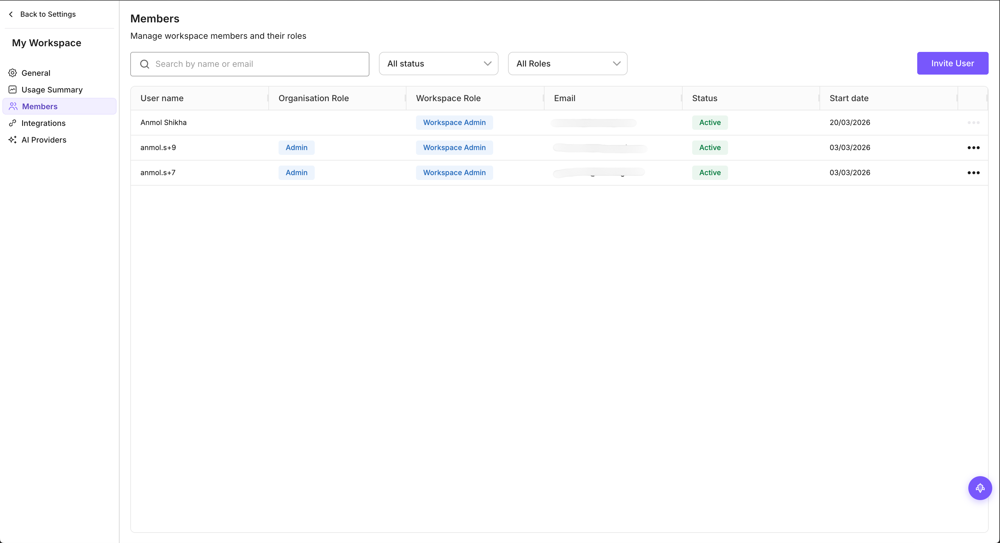
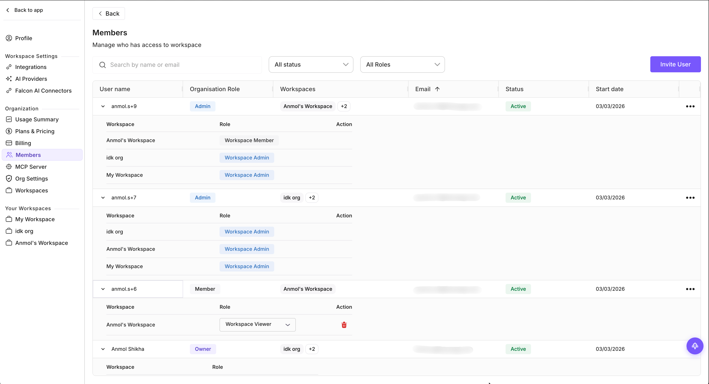
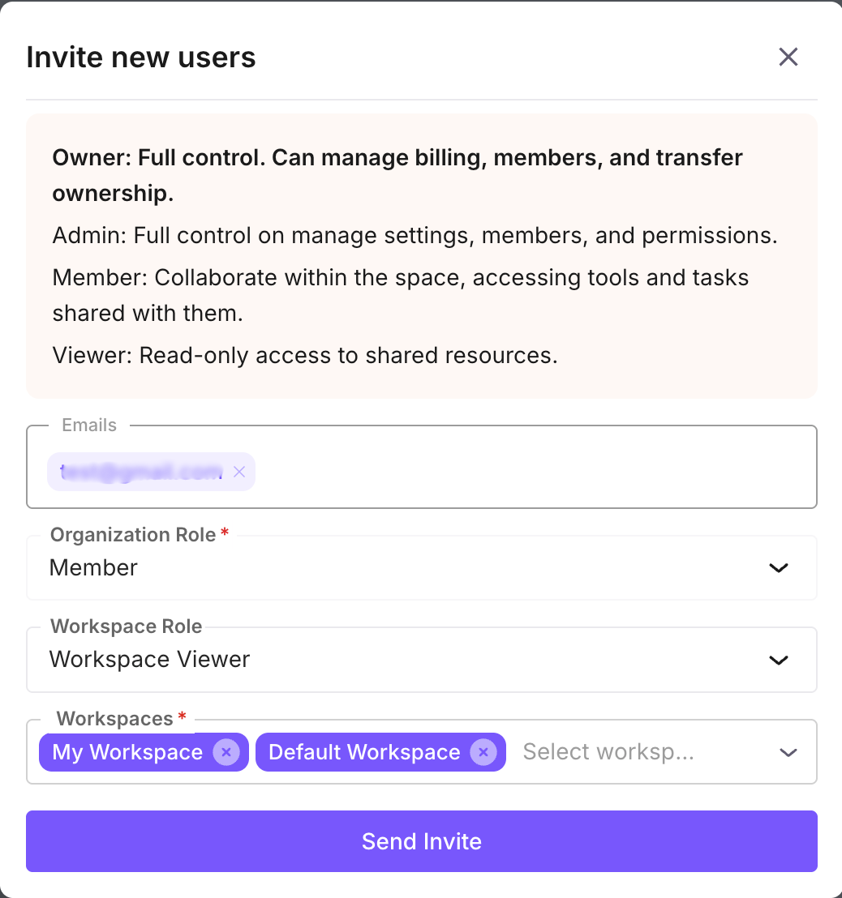
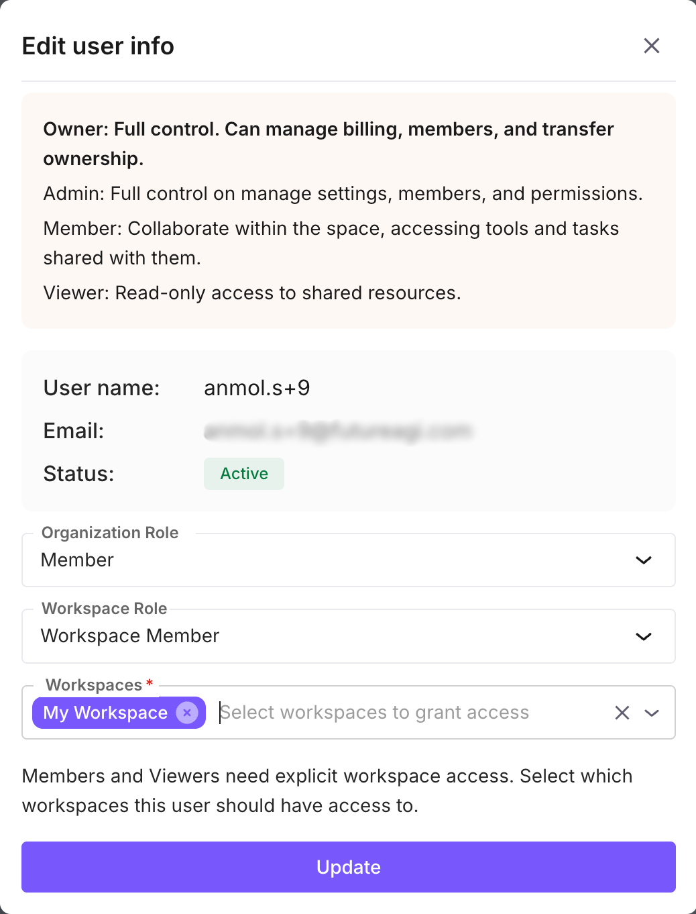

Future AGI uses role-based access control (RBAC) at two levels: organization roles and workspace roles. To give someone access to one [workspace](/docs/admin-settings/workspace-management) without opening every other project, choose their organization role first. Then check their workspace membership: organization Owners and Admins have access everywhere, but Members and Viewers need an explicit assignment.

<Prerequisites title="Before you start">
- For organization-wide [member management](/docs/admin-settings/user-management), use an Owner or Admin account. A Workspace Admin can invite people to the workspaces they manage, not grant access across the organization.
</Prerequisites>

## Organization roles

Every user in your organization has one of four roles. These control what the user can do across the entire organization.

| Organization role | What it allows |
| --- | --- |
| Owner | Full control over the organization. Can manage [billing](/docs/billing), settings, members and all workspaces. Every organization must have at least one Owner. |
| Admin | Same access as Owner, except cannot manage Owners or other Admins. Automatically gets admin access to all workspaces. |
| Member | Can view, create and edit resources in workspaces they belong to. Cannot manage members or organization settings. |
| Viewer | Read-only access. Can view data but cannot create, edit or delete anything. |

## Workspace roles

Workspaces group projects, [datasets](/docs/dataset), [traces](/docs/observe/concepts/traces) and [annotation queues](/docs/annotations/concepts/queues-and-items). Their settings show which members have been explicitly assigned.

| Workspace role | View resources | Create and edit resources | Manage members and invite people to this workspace |
| --- | --- | --- | --- |
| Workspace Admin | Yes | Yes | Yes |
| Workspace Member | Yes | Yes | No |
| Workspace Viewer | Yes | No | No |

<Mermaid chart={`
flowchart TD
    accTitle: How a member gets workspace access
    accDescr: Organization Owners and Admins have admin access to every workspace. Other users need explicit membership; without it, they have no access to that workspace.
    O{"Organization role?"} -->|Owner or Admin| A["Admin in every workspace"]
    O -->|Member or Viewer| M{"Workspace membership?"}
    M -->|No| N["No access here"]
    M -->|Yes| R["Check assigned roles here"]
`} />

A user's effective workspace access is the higher of their organization role and their workspace role:

- An organization Admin always has Workspace Admin access everywhere, even without explicit workspace membership.
- An organization Member with Workspace Admin on a specific workspace gets admin access only in that workspace.
- An organization Member with no workspace membership has no access to that workspace.

One person can belong to several workspaces and have a different role in each. For example, an organization Member with a Workspace Admin assignment in staging can manage staging members, but cannot even open an unassigned workspace. An organization Admin doesn't need either assignment.

## Invite a teammate

1. Open **Organization > Members**.
2. Click **Invite User**.

3. Enter the teammate's address in **Emails**.
4. Select their **Organization Role**.

   You can invite at or below your own role; an organization Admin cannot invite an Owner.

5. Choose the **Workspace Role** to grant.
6. Select the intended **Workspaces**.

7. Click **Send Invite**.

   The recipient gets an email. Their status is **Pending** until they accept; an unaccepted invite expires after seven days and can be resent from the members list.

## Check or change access

1. Find the teammate on the members list.
2. Expand their row to inspect the workspaces and roles shown.
3. Open **Edit user info** for that member if the assignment doesn't match the intended access.
4. Change the **Organization Role**, **Workspace Role** or **Workspaces**.
5. Click **Update**.

Organization Owners and Admins can change roles within their authority. An Admin cannot manage anyone at or above Admin; only Owners can manage other Owners. Promotion to organization Admin or Owner grants admin access to every workspace. Demoting an Admin to Member restores the boundary of their explicit workspace memberships.

### Remove or restore a member

- Removing someone from a workspace removes that assignment, not their organization membership. It does not override automatic access for an organization Owner or Admin.
- Removing someone from the organization immediately revokes access to its workspaces and resources. Their data, including annotations and scores, is preserved.
- You cannot remove yourself or the last Owner. Transfer ownership first if the only Owner needs to leave.
- Reactivate a previously removed user from the members list to restore their original role.

## Permission summary

| Organization-wide action | Owner | Admin | Member | Viewer |
| --- | --- | --- | --- | --- |
| View traces, [sessions](/docs/observe/concepts/sessions) and datasets in accessible workspaces | Yes | Yes | Yes | Yes |
| Create or edit traces, datasets and queues where editing is permitted | Yes | Yes | Yes | No |
| Manage organization settings or billing | Yes | Yes | No | No |
| Invite and manage members organization-wide | Yes | Yes, within role limits | No | No |
| Manage Owners and Admins | Yes | No | No | No |
| Access all workspaces automatically | Yes | Yes | No | No |
| Create or delete workspaces | Yes | Yes | No | No |

The organization-wide invitation row doesn't describe a workspace-scoped invitation: a Workspace Admin's authority ends at the workspaces they manage.

## Next

- [User management](/docs/admin-settings/user-management): invite users and see whether an invitation is still pending.
- [Workspace management](/docs/admin-settings/workspace-management): create a workspace and add members with a workspace role.
- [Manage API keys](/docs/admin-settings/api-keys): as an organization Owner, create or rotate the credentials used by SDKs.
- [Organization settings](/docs/admin-settings/organization-settings): set the organization name or require two-factor authentication.
